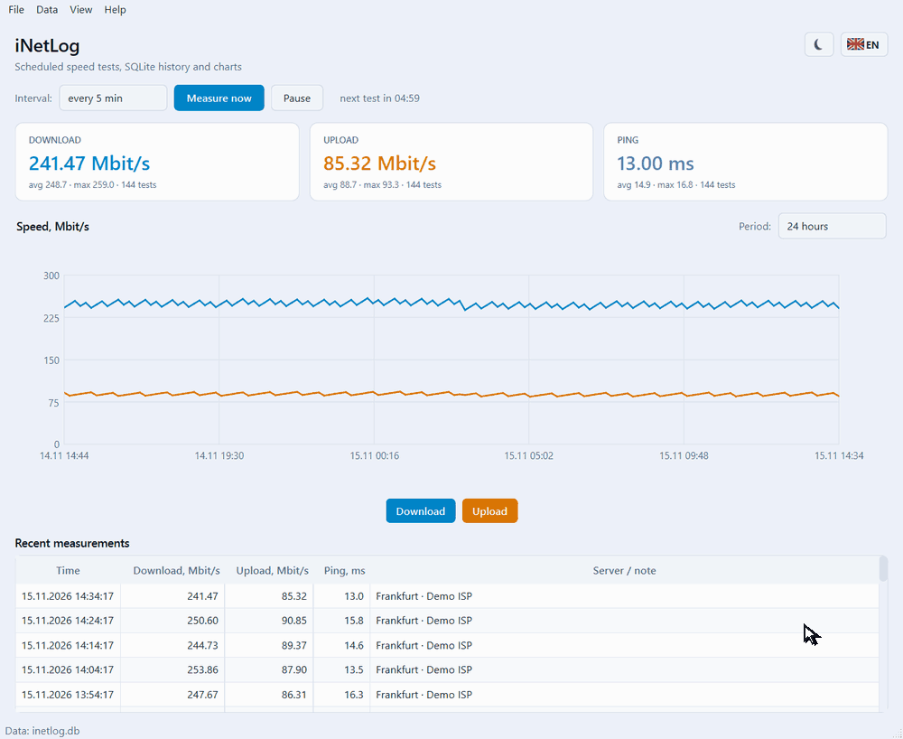

# iNetLog — монитор скорости интернета

**iNetLog** — лёгкое приложение для Windows, которое следит за качеством интернет-соединения:
регулярно измеряет скорость и задержку, сохраняет историю и показывает её на наглядных
графиках. Работает без установки, из одного файла.

*English version: [README.md](README.md).*



## Возможности

* **Автоматические замеры** Download, Upload и Ping с выбранным интервалом — от 1 минуты
  до часа. Замер можно запустить в любой момент вручную.
* **История измерений** сохраняется локально и не теряется между запусками. Неудачные
  попытки тоже фиксируются — видно, когда и почему пропала связь.
* **Графики скорости** за 24 часа, 7 дней, 30 дней, всё время или произвольный диапазон
  дат. Видны только нужные серии — Download, Upload или обе.
* **Масштабирование графика**: колесо мыши — по времени, рамка — по области,
  перетаскивание — сдвиг, двойной клик — сброс. Ось скорости подстраивается автоматически.
* **Сводка за период**: текущие значения, среднее и максимум, а также таблица последних
  замеров с сервером и провайдером.
* **Светлая и тёмная темы** — переключение в меню «Вид» или кнопкой с солнцем/луной.
* **Русский и английский интерфейс** — английский по умолчанию; язык меняется на лету
  в меню «Вид» или кнопкой с флагом, без перезапуска.
* **Экспорт истории** в CSV и Excel — удобно для отчётов и анализа в таблицах.
* **Автозапуск при старте Windows** — приложение стартует свёрнутым и продолжает вести
  журнал в фоне.
* **Портативность** — все данные рядом с программой, папку можно просто перенести.

## Быстрый старт

Скачайте `iNetLog.exe` со страницы Releases и запустите — установка не требуется. Первый
замер выполнится автоматически через пару секунд после запуска, далее — по выбранному
интервалу.

Приложение можно свернуть и оставить работать: замеры идут по расписанию, а окно
открывается, когда нужно посмотреть результаты.

## Запуск из исходников

Нужен Python 3.10–3.13.

```powershell
py -3.12 -m venv .venv
.venv\Scripts\python -m pip install -r requirements.txt
.venv\Scripts\python main.py
```

## Где хранятся данные

| Файл | Что внутри |
| --- | --- |
| `inetlog.db` | история замеров |
| `inetlog.ini` | настройки: тема, язык, интервал, период, видимость графиков |

Файлы создаются рядом с `iNetLog.exe`. Если папка недоступна для записи, они
сохраняются в `%APPDATA%\iNetLog`.

## Экспорт и горячие клавиши

| Действие | Как вызвать |
| --- | --- |
| Экспорт в CSV | «Файл» → «Экспорт в CSV…», `Ctrl+E` |
| Экспорт в Excel | «Файл» → «Экспорт в Excel…», `Ctrl+Shift+E` |
| Измерить сейчас | «Данные» → «Измерить сейчас», `Ctrl+R` |
| Показать/скрыть графики | «Вид» → «Показывать графики», `Ctrl+G` |
| Сбросить масштаб графика | «Вид» → «Сбросить масштаб графика», `Ctrl+0` |
| Выход | `Ctrl+Q` |

Экспортируется вся история измерений, независимо от выбранного периода на графике.
Файл Excel открывается с готовой шапкой и фильтрами, ошибки выделены красным.

## Автозапуск

Включите «Данные» → «Запускать при старте Windows». Права администратора не нужны,
окно при старте будет свёрнутым. При переносе программы в другую папку включите
автозапуск заново, чтобы обновился путь.

## Полезно знать

* Замер занимает всю доступную полосу канала — для точных результатов закройте торренты
  и стримы.
* Интерфейс не зависает во время замера: измерения идут в фоне.
* Время замеров берётся по локальным часам компьютера.

## Лицензия

[MIT](LICENSE)
